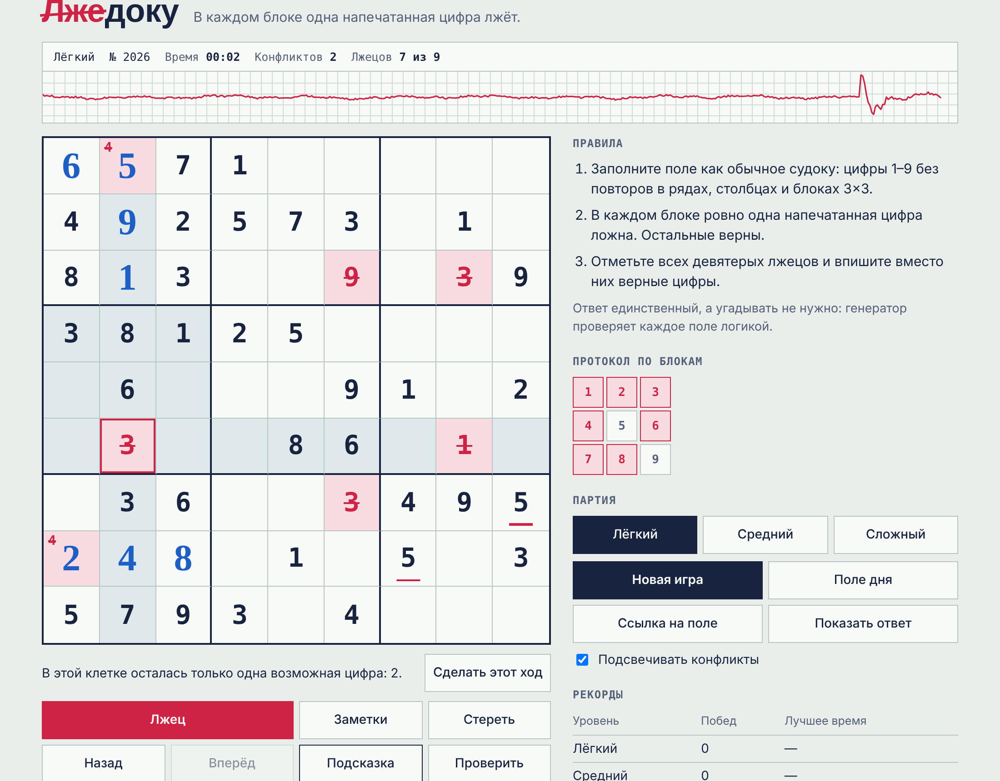

# Лжедоку

Судоку для тех, кто устал от судоку. В каждом блоке 3×3 одна напечатанная цифра лжёт, поэтому нельзя слепо доверять даже условию: нужно заполнить поле и вычислить всех девятерых лжецов.



Игра работает целиком в браузере. Ей не нужны сервер, база данных, токены и платные сервисы.

## Правила

1. Заполните поле как обычное судоку: цифры 1–9 без повторов в рядах, столбцах и блоках.
2. В каждом блоке ровно одна напечатанная цифра ложна, остальные верны.
3. Отметьте всех лжецов и впишите вместо них верные цифры.

Начинать удобно с блока, где есть две одинаковые цифры: одна из них лжец, поэтому остальные цифры блока верны.

| Уровень | Пары одинаковых цифр | Рассуждения «допустим, что…» |
|---|---|---|
| Лёгкий | В каждом блоке, лжец виден по повтору в ряду или столбце | Не нужны |
| Средний | В 5 блоках | Не больше 2 |
| Сложный | В 2 блоках | Не больше 7 |

## Возможности

- Бесконечные уровни трёх сложностей из генератора
- Единственное решение, которое находится логикой, без угадывания
- Подсказки с объяснением следующего шага
- Заметки, отмена ходов, подсветка конфликтов и проверка поля
- «Поле дня» и ссылки на конкретное поле без сервера: уровень задаётся сидом
- Автосохранение партии и рекорды в браузере
- Лента полиграфа, которая реагирует на число конфликтов на поле
- Управление с клавиатуры, адаптивная вёрстка и тёмная тема

## Запуск

Нужен [Node.js](https://nodejs.org/) версии 22 или новее. Сторонних зависимостей нет, поэтому `npm install` не требуется.

```bash
npm start       # игра на http://localhost:8080
npm test        # автотесты
npm run build   # один файл dist/lzhedoku.html, открывается двойным щелчком
```

## Как опубликовать на GitHub Pages

1. Создайте публичный репозиторий и загрузите в него файлы проекта.
2. Откройте **Settings → Pages**.
3. В разделе **Source** выберите **Deploy from a branch**, ветку `main` и папку `/ (root)`.
4. Нажмите **Save**. Через пару минут игра появится по адресу `https://ИМЯ.github.io/РЕПОЗИТОРИЙ/`.

## Устройство проекта

| Файл | Назначение |
|---|---|
| `src/grid.js` | Геометрия поля |
| `src/rng.js` | Генератор случайных чисел с сидом |
| `src/logic.js` | Логический решатель, оценка сложности, шаги подсказок |
| `src/generator.js` | Создание уровней |
| `src/verify.js` | Независимая проверка единственности полным перебором |
| `src/game.js` | Правила партии без привязки к браузеру |
| `src/storage.js` | Сохранение в браузере |
| `src/polygraph.js` | Лента полиграфа на Canvas |
| `src/main.js` | Связь логики со страницей |
| `tests/` | Автотесты на `node:test` |

Подробности описаны в [docs/ARCHITECTURE.md](docs/ARCHITECTURE.md).

## Лицензия

[MIT](LICENSE)
