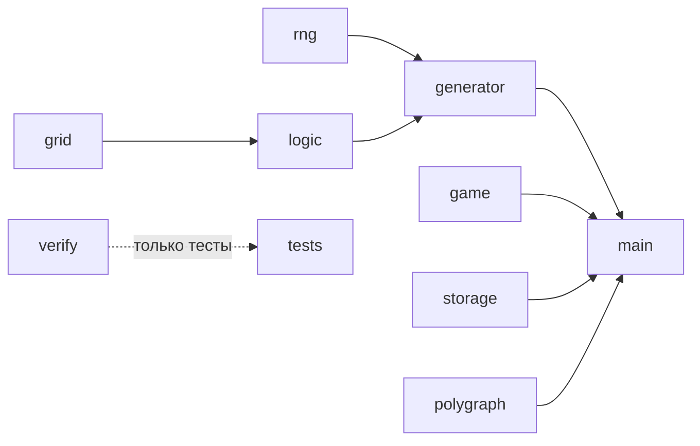

# Архитектура Лжедоку

## Главная идея

Логика игры отделена от страницы. Модули `grid`, `rng`, `logic`, `generator`, `verify` и `game` не обращаются к браузеру, поэтому их можно запускать в тестах на Node.js. Страницей занимаются `main`, `polygraph` и `storage`.

## Как создаётся уровень

1. Строится полное правильное судоку перебором со случайным порядком цифр.
2. В каждом блоке одна случайная клетка получает неверную цифру. Это лжецы.
3. Правдивые цифры убираются по одной в случайном порядке.
4. После каждого удаления запускается логический решатель. Если он не справился или поле стало сложнее лимита уровня, цифра возвращается.
5. В каждом блоке остаётся не меньше трёх цифр, чтобы выбор лжеца оставался настоящим выбором.

Лимиты уровней заданы в `DIFFICULTIES`: число цифр на поле и допустимое число рассуждений «от противного». Если условия не выполняются, генератор начинает заново и постепенно разрешает немного больше цифр.

## Как рассуждает решатель

Каждая клетка хранит битовую маску возможных цифр. Стартовая цифра `d` сначала ничего не гарантирует:

- цифра правдива, если в маске осталась только `d`;
- цифра лжёт, если `d` вычеркнута из маски.

Правила применяются, пока что-то меняется:

- единственная возможная цифра в клетке;
- единственное место для цифры в ряду, столбце или блоке;
- если лжец блока найден, все остальные цифры блока правдивы;
- если правдивы все цифры блока, кроме одной, оставшаяся лжёт.

Когда простых правил не хватает, решатель делает предположение о стартовой цифре и проставляет следствия. Противоречие доказывает обратное. Число таких шагов служит оценкой сложности. Для сложного уровня допускаются также предположения по клеткам с двумя кандидатами.

Все выводы решателя логически обязательны. Значит, если он заполнил поле, другого решения нет. Перебор в `verify.js` написан отдельно и подтверждает это в тестах.

Каждый вывод записывается как шаг с текстом объяснения. Из этих шагов строятся подсказки.

## Почему обошлись без сервера

Уровень полностью определяется парой «сложность и сид». Ссылка `#hard-4242` воссоздаёт то же поле у любого игрока. Сид «Поля дня» вычисляется из даты. Партия и рекорды лежат в `localStorage`.

## Сложность алгоритмов

Поиск решения в общем случае экспоненциальный, но поле имеет постоянный размер 9×9. На практике средний уровень создаётся примерно за 0,15 с, а сложный примерно за секунду.
